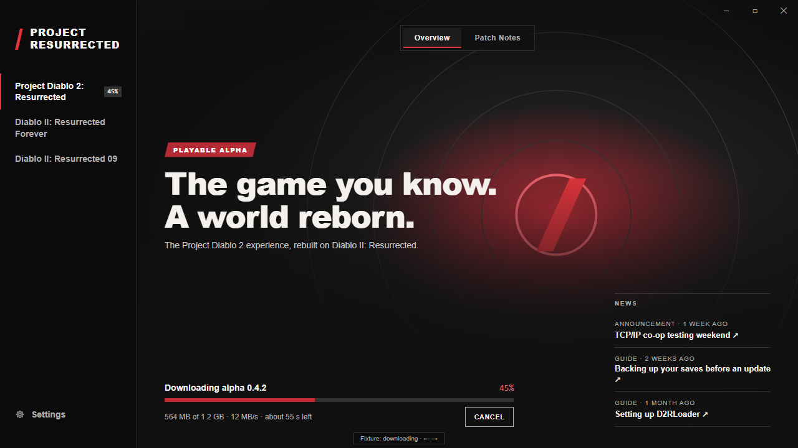
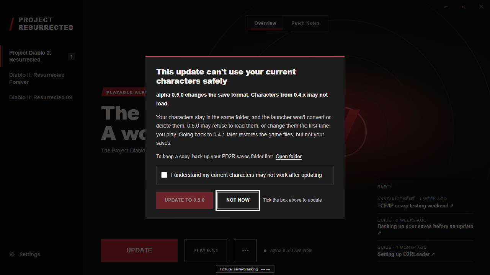
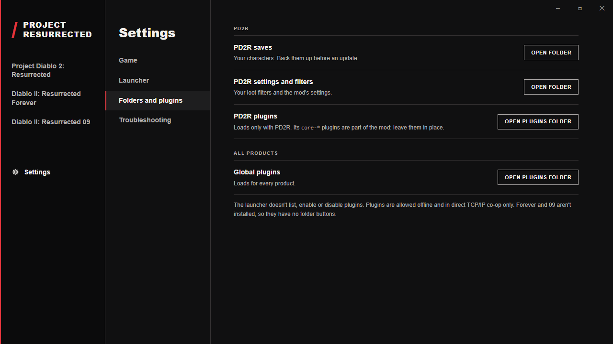

# Resurrected Launcher

The shared Windows launcher for Project Diablo 2: Resurrected, Diablo II: Resurrected Forever and Diablo II: Resurrected 09.

[](https://github.com/synpoox/resurrected-launcher/actions/workflows/ci.yml)
[](LICENSE)

> [!NOTE]
> **Status: in development, not released.** The native core is implemented and tested. The UI currently runs on fixture data; connecting it to the native commands is [#79](https://github.com/synpoox/resurrected-launcher/issues/79). Product names and the **Project Resurrected** umbrella label are provisional (see [GLOSSARY.md](GLOSSARY.md)).

## What it is

A desktop app that installs, updates, repairs and launches the project's mods on top of an existing Diablo II: Resurrected (D2R) installation. It reads a publisher-maintained [release feed and release manifests](docs/specs/release-manifest.md), applies each release as a recoverable transaction, and keeps player files (saves, edited loot filters, personal settings) out of the way.

The launcher offers three **products**. Only Project Diablo 2: Resurrected (PD2R) has a release today; Forever and 09 show as Coming soon.

## Features

**Implemented** (native core, `src-tauri/`)

- **Catalog**: downloads and validates the release feed and release manifests (schema 3, HTTPS only, pinned sizes and SHA-256), caching only complete, valid metadata.
- **Install, adopt, repair, update, uninstall**, with cancel and restart recovery from a journal. Managed files are separated from player files; save-breaking releases need explicit acknowledgement ([ADR 0001](docs/adr/0001-warn-on-save-breaking-updates-without-forced-isolation.md)).
- **Archive extraction** only through a bundled, hash-pinned 7-Zip console ([third-party notes](docs/third-party.md)).
- **Game detection and launch**: finds D2R locations, checks the game build and loader, launches a product explicitly and tracks the running game.
- **Settings commands**: open saves, settings and plugin folders; Start with Windows; release notes; a diagnostics report the player reviews before saving (nothing is sent).

**Implemented on fixtures** (UI, `src/`)

- Shell, sidebar and product page with Overview and Patch Notes tabs, covering every journey state.
- Settings: Game, Launcher, Folders and plugins, Troubleshooting.

**Planned**

- UI wired to the native commands — [#79](https://github.com/synpoox/resurrected-launcher/issues/79)
- Tray, frameless window, single instance and close-to-tray — [#75](https://github.com/synpoox/resurrected-launcher/issues/75)
- Signed launcher self-updates (Tauri updater) — [#78](https://github.com/synpoox/resurrected-launcher/issues/78), [#88](https://github.com/synpoox/resurrected-launcher/issues/88)
- News feed source — [#80](https://github.com/synpoox/resurrected-launcher/issues/80)

Out of scope for now: plugin catalogs or toggles (players install plugins manually, [ADR 0004](docs/adr/0004-manual-plugins-allowed-in-direct-coop.md)), and project accounts and hosted online features, which have their own gates in the [v1 spec](docs/specs/launcher-v1.md).

## Screenshots

Captured from the fixture-driven UI; copy, versions and hero art are placeholders.

| Product page | Download in progress |
| --- | --- |
|  |  |
| **Save-breaking update warning** | **Settings: folders and plugins** |
|  |  |

More states at 1280×720 and 1024×640: [`docs/screenshots/76/`](docs/screenshots/76) (product page) and [`docs/screenshots/77/`](docs/screenshots/77) (settings).

## Tech stack

| Layer | Stack |
| --- | --- |
| App shell | [Tauri 2](https://tauri.app) ([ADR 0003](docs/adr/0003-tauri-with-signed-launcher-updates.md)) |
| UI | React 19, TypeScript, Vite |
| Native core | Rust 1.90 (`src-tauri/`) |
| Tests | Vitest + Testing Library; `cargo test` |
| Installer | NSIS, per-user install |

## Requirements

- **Windows 10 or 11.** The native core uses Windows APIs, and CI runs on `windows-latest`.
- **Node.js 22** and npm.
- **Rust via [rustup](https://rustup.rs)**. `src-tauri/rust-toolchain.toml` pins 1.90.0 with clippy and rustfmt; rustup installs it on first use.
- [Tauri's Windows prerequisites](https://tauri.app/start/prerequisites/#windows): Microsoft C++ Build Tools and WebView2.

Development needs no D2R installation: the UI uses fixtures and the Rust tests use disposable fixture installations.

## Getting started

```sh
git clone https://github.com/synpoox/resurrected-launcher.git
cd resurrected-launcher
npm ci
npm run tauri dev
```

In dev builds, `?fixture=<key>` picks a journey state and ← / → cycle through them. To work on the UI in a browser without the native shell, run `npm run dev` and open <http://localhost:1420>.

Release build (writes an NSIS installer under `src-tauri/target/release/bundle/nsis/`):

```sh
npx tauri build
```

Signed release builds run in CI; see [launcher signing](docs/release/launcher-signing.md).

## Tests and lint

These match [CI](.github/workflows/ci.yml).

Frontend, from the repository root:

```sh
npm run typecheck
npm run lint
npm test
```

Native core, from `src-tauri/`:

```sh
cd src-tauri
cargo fmt --check
cargo clippy --all-targets --locked -- -D warnings
cargo test --locked
```

The slice 3 gate's phase A runs against a real D2R copy only when `SLICE3_GATE_D2R` is set; otherwise it skips. Point it only at a disposable copy, never at a live installation.

## Project layout

```text
src/                 React UI
  api/               LauncherApi seam and fixture scenes
  shell/             window, sidebar, title bar
  product/           product page, Patch Notes, journey dialogs
  settings/          Settings and troubleshooting
src-tauri/           Tauri app and Rust native core
  src/app/           Tauri commands, window, settings
  src/catalog/       release feed and manifest validation
  src/install/       download, extract, install transactions, recovery
  src/game/          D2R detection, readiness, launch, process tracking
  src/state/         preferences, cached metadata, diagnostics
  src/contract/      types shared with the frontend
  resources/7zip/    bundled 7-Zip console
  tests/             integration tests, failure matrix, slice 3 gate
fixtures/            catalog documents and fixture product installations
docs/                specs, ADRs, release docs, screenshots
```

## Documentation

| Topic | Document |
| --- | --- |
| Vocabulary | [GLOSSARY.md](GLOSSARY.md) |
| Launcher v1 spec (index) | [docs/specs/launcher-v1.md](docs/specs/launcher-v1.md) |
| UI design spec | [docs/specs/launcher-ui.md](docs/specs/launcher-ui.md) |
| Release feed and manifest | [docs/specs/release-manifest.md](docs/specs/release-manifest.md) |
| Architecture decisions | [docs/adr/](docs/adr) |
| Launcher release signing | [docs/release/launcher-signing.md](docs/release/launcher-signing.md) |
| Third-party components | [docs/third-party.md](docs/third-party.md) |
| Shared website context | [docs/agents/web-context.md](docs/agents/web-context.md) |

## Contributing

Work is tracked in [GitHub Issues](https://github.com/synpoox/resurrected-launcher/issues); the v1 build is [#41](https://github.com/synpoox/resurrected-launcher/issues/41). Read [AGENTS.md](AGENTS.md) and the [glossary](GLOSSARY.md) first, use glossary terms in issues and PRs, and flag any change that contradicts an [ADR](docs/adr). PRs must pass CI.

## License

[MIT](LICENSE) © 2026 synpoox.

**Third-party:** the bundled 7-Zip console in [`src-tauri/resources/7zip/`](src-tauri/resources/7zip) keeps its own license (GNU LGPL 2.1+ with BSD parts); see its [`License.txt`](src-tauri/resources/7zip/License.txt) and [docs/third-party.md](docs/third-party.md).
