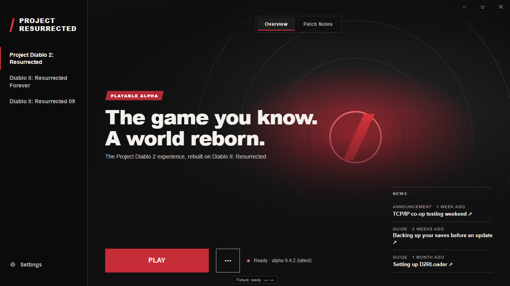

# Resurrected Launcher

Install, update and play the Project Resurrected mods for Diablo II: Resurrected, all from one launcher.

Preview build with placeholder art and text. Names, including Project Resurrected, are provisional.

## What it does

- **One place for every mod.** Project Diablo 2: Resurrected has an alpha release. Diablo II: Resurrected Forever and Diablo II: Resurrected 09 are coming soon.
- **Installs and updates on top of your own D2R.** It finds your game, downloads releases and checks every file.
- **Leaves your saves alone.** Installing or updating keeps your saves, edited loot filters and settings in place, and the launcher never converts them. If a release is marked save-breaking, it warns you and asks you to confirm before updating.
- **Recovers from problems.** A failed or cancelled update rolls back cleanly, and Repair restores missing or damaged mod files.
- **Shows Patch Notes** for each release, including offline for the version you have installed.

## Download

**There is no release yet.** The launcher is still in development. When it ships, the installer will be on the [Releases page](https://github.com/synpoox/resurrected-launcher/releases).

## System requirements

- Windows 10 (22H2) or Windows 11, 64-bit
- Your own Diablo II: Resurrected installation
- [D2RLoader](https://d2rloader.net/download.html). The launcher tells you if it is missing or the wrong version.
- An internet connection to install and update. Installed mods also play offline.

## FAQ

**Will an update wipe my characters?**
The launcher doesn't delete or convert them. The new game version can still refuse or change them, though, and going back to an older version restores game files, not saves. The launcher warns you before an update marked save-breaking. Back up your saves before updating (Settings → Folders and plugins → Open folder).

**Can I use plugins?**
Yes, if you install them yourself. They are allowed in offline play and direct TCP/IP co-op, but not in project-hosted multiplayer or ladder play. Settings → Folders and plugins opens the plugin folders.

**The game won't start or files look broken.**
Open the **⋯** menu next to Play and choose **Repair**. It restores missing or damaged mod files and keeps your saves and edited filters. If that doesn't fix it, use Settings → Troubleshooting → Export diagnostics. You review the report and save it yourself; nothing is sent.

## License

[MIT](LICENSE). The bundled 7-Zip keeps its own license ([details](docs/third-party.md)).

---

Building from source or contributing? See [CONTRIBUTING.md](CONTRIBUTING.md).
